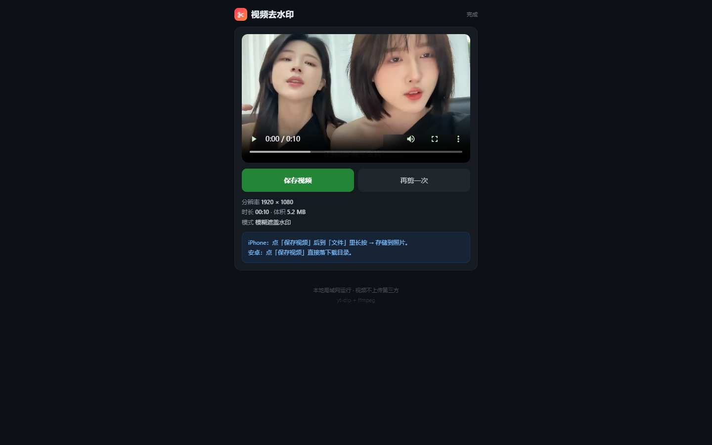

# 视频去水印

粘贴一个视频链接，框住水印，导出干净的 MP4。

自己跑在自己机器上：解析靠 `yt-dlp`，转码和打码靠 `ffmpeg`，视频不经过任何第三方。



---

## 一、它解决什么问题

从抖音、B站、小红书这些平台下的视频，经常带平台水印。市面上的在线工具要么限速、要么要注册、要么把视频传给别人。

这个工具就三件事：

1. 把视频抓下来（`yt-dlp`，抖音另走浏览器抓流）
2. 让你在画面上框住水印（拖动四角，带放大镜）
3. 把水印那一块切掉或糊掉，导出 MP4

全程本地，不联网上传。

---

## 二、支持的平台

| 平台 | 状态 | 备注 |
|---|---|---|
| B站 | ✅ | 1080P；番剧/大会员需 Cookie |
| 小红书 | ✅ | 短链自动展开 |
| 抖音 | ✅ | 需要 Chromium（Playwright 或系统 chromium） |
| 微博 / AcFun / 虎牙 | ✅ | 直连 yt-dlp |
| 网易云 / QQ音乐 / 喜马拉雅 | ✅ | 只出音频 |
| 快手 / 腾讯视频 / 芒果TV / 视频号 | ❌ | yt-dlp 无对应提取器 |
| 爱奇艺 / 斗鱼 / TikTok | ❌ | 提取器失效或缺依赖 |

判定标准是「解析成功 + 真下载到文件 + ffprobe 验出画面」，只有解析通过不算。逐条实测记录见 [平台支持清单.md](平台支持清单.md)。

---

## 三、快速开始

### 方式 A：直接跑（推荐）

```bash
git clone https://github.com/lanxiake/video-downloader-web.git
cd video-downloader-web
bash deploy.sh
```

`deploy.sh` 会做这几件事：建 venv、装依赖、生成随机访问码、写 `start.sh`、注册 systemd 用户服务。跑完会打印访问地址和访问码。

需要 `python3`（3.9+）和 `ffmpeg`。Debian/Ubuntu 下：

```bash
sudo apt install python3 python3-venv ffmpeg
```

`deploy.sh` 会顺便装 Playwright 的 chromium（约 180MB），这是抖音能解析的前提。装失败也不致命，会自动退回系统 chromium。

### 方式 B：Docker

```bash
VIDEOWM_TOKEN=你的访问码 docker compose up -d
```

访问 `http://服务器IP:8848/?k=你的访问码`。

### 方式 C：Termux（Android 手机）

```bash
bash install-termux.sh
```

手机会额外套装 `chromium`（159MB 下载 / 662MB 安装），走 Chromium + CDP 抓抖音。装不了 Playwright，因为 Playwright 没有 Android 构建。

### 抖音到底走哪条路

按可用性依次尝试，哪条通了用哪条：

| 顺序 | 方式 | 适用 |
|---|---|---|
| 1 | Playwright + chromium | 电脑/服务器（`pip install playwright && playwright install chromium`） |
| 2 | 系统 chromium + CDP | Termux、或已装 `apt install chromium` 的服务器 |
| 3 | 都没有 | 返回明确提示，告诉你去装什么 |

**关键细节（踩过的坑）**：

- **必须用移动 UA + 移动视口**。桌面 UA 会拿到 2 秒的预览片（hevc / 222KB），移动 UA 才吐 `douyinvod` 的正片地址。移动 UA 千万别配 `window-size=1280,800`，那个组合本身就是特征
- **URL 必须规范成 `www.douyin.com/video/<id>`**。短链展开后是 `iesdouyin.com/share/video/...`，这个分享页在移动 UA 下永远拿不到流
- **服务用子进程跑抓流**（`cdp_cli.py`）。同样代码在 daemon 进程内起浏览器会莫名失败，隔离后就正常

---

## 四、怎么用

1. **粘链接** —— 抖音/B站/小红书的分享文本整段粘进去，会自动抠出 URL
2. **等下载** —— 界面上有进度和速度
3. **框水印** —— 拖绿框四角（手机上会弹出放大镜），或者点「左上角/右上角/…」预设
4. **选方式** —— 裁切（切掉含白印那条边）/ 打码（只糊那一块，画幅不变）
5. **导出** —— 处理完直接播放预览，长按保存

### 四种模式的界面差异

| 模式 | 框 | 把手（可拖） | 框外遮罩 |
|---|---|---|---|
| 标准裁切 | 显示 | 隐藏 | 压暗（表示会被切掉） |
| 标准打码 | 显示 | 隐藏 | 无 |
| 自定义裁切 | 显示 | 显示 | 压暗 |
| 自定义打码 | 显示 | 显示 | 无 |

切换模式时框会重置回该平台的预设位置，避免拿打码的框去裁切。

### 拖动时的细节

- **放大镜**：手指上方弹出 140px 圆形放大窗（2.4 倍 + 十字准星）。小画布上水印只有十几像素高，没有放大镜根本对不准
- **框外拖拽**：画面空白处按下拉动就是一个新框
- **吸附**：边缘 / 中心 / 三等分线，1.8% 内自动对齐
- **↺ 恢复自动**：拖乱了点一下回到平台预设
- **画面不动**：拖框时预览始终是整幅原画面，只有框在动

---

## 五、配置

全部走环境变量，都有默认值：

| 变量 | 默认 | 说明 |
|---|---|---|
| `VIDEOWM_TOKEN` | 随机生成 | 访问码。不设就去 `.token` 文件读 |
| `VIDEOWM_PORT` | 8848 | 监听端口 |
| `VIDEOWM_MEDIA` | `./media` | 产物目录 |
| `VIDEOWM_TTL_MIN` | 0 | 产物保留分钟数，0 = 不自动删 |
| `VIDEOWM_MAX_DURATION` | 1800 | 视频最长秒数 |
| `VIDEOWM_MAX_SIZE` | 500 | 视频最大 MB |
| `VIDEOWM_BASE` | 空 | 反向代理前缀，如 `/videowm` |
| `VIDEOWM_PUBLIC` | 空 | 对外地址，用于显示二维码 |

### 挂在反代后面

nginx 示例：

```nginx
location /videowm/ {
    proxy_pass http://127.0.0.1:8848/;
    proxy_set_header Host $host;
    proxy_read_timeout 600s;      # 大文件下载别掐断
    client_max_body_size 0;
}
```

同时设 `VIDEOWM_BASE=/videowm`，否则前端拼的接口路径会错。

---

## 六、解析缓存

同一条视频解析过一次就不再重复下载。

- 缓存文件：`<media>/.parse-cache.json`
- Key 用**视频 ID 而不是 URL**，所以换短链、换分享文案都能命中
- 有效期 24 小时；文件被清理掉就自动作废

实测：抖音第一次 11 秒，第二次 1 秒。

---

## 七、已知限制

- **付费/会员内容不做**。工具不绕过任何限制
- **抖音最脆弱**。它的前端一改版，抓流就可能挂
- **B站 CDN 在部分网络中很慢**（实测 400–700KB/s）。下载已开 `--concurrent-fragments 4` 和 60 秒 socket 超时兜底，否则 70MB 的 1080P 会中途断
- **抖音的直链有时效**，解析后要尽快下载
- **微信视频号暂不支持**

---

## 八、更多文档

- [平台支持清单.md](平台支持清单.md) —— 14 个平台的实测结果与复验命令
- [水印位置实测.md](水印位置实测.md) —— 各平台横屏/竖屏水印坐标及测量方法
- [抖音快手解析研究.md](抖音快手解析研究.md) —— a_bogus 签名逆向、UIFID 风控、CDP 抓流踩坑记录


---

## 十、长期运行

### 服务管理

```bash
systemctl --user status videowm      # 看状态
systemctl --user restart videowm     # 重启
journalctl --user -u videowm -f      # 跟日志
```

`Restart=always` 已配好，进程挂了 3 秒内自动拉起。用户级服务要保证开机自启，需要开 linger：

```bash
sudo loginctl enable-linger $USER
```

### 访问码

首次 `deploy.sh` 会生成随机访问码写到 `.token`（权限 600）。改访问码：

```bash
echo "新的访问码" > .token
systemctl --user restart videowm
```

### 磁盘占用

产物默认不自动清理（`VIDEOWM_TTL_MIN=0`）。要开启自动清理：

```bash
# systemd 里加一行
Environment=VIDEOWM_TTL_MIN=1440     # 24 小时后删
```

清理只删产物文件，不动 `media/` 目录本身。

### 内网穿透

如果服务装在没公网 IP 的机器上，cpolar / frp / cloudflared 任选其一。cpolar 示例：

```yaml
# ~/.cpolar/videowm.yml
authtoken: 你的token
tunnels:
  videowm:
    proto: http
    addr: "8848"
    region: "cn"
    subdomain: "你的子域名"
```

```bash
cpolar start videowm -config=~/.cpolar/videowm.yml
```

配成 systemd 用户服务后与主服务一起开机自启。

---

## 九、许可

MIT
